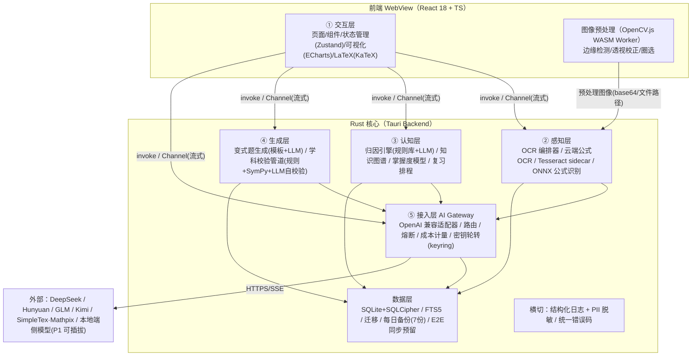
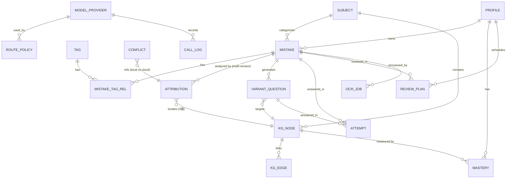
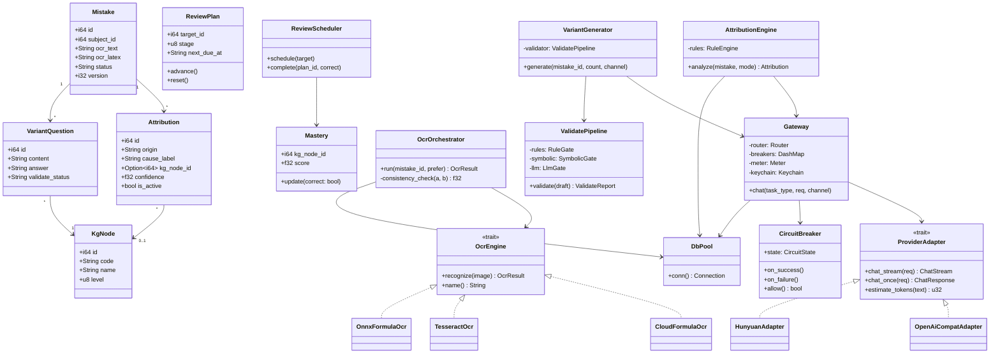
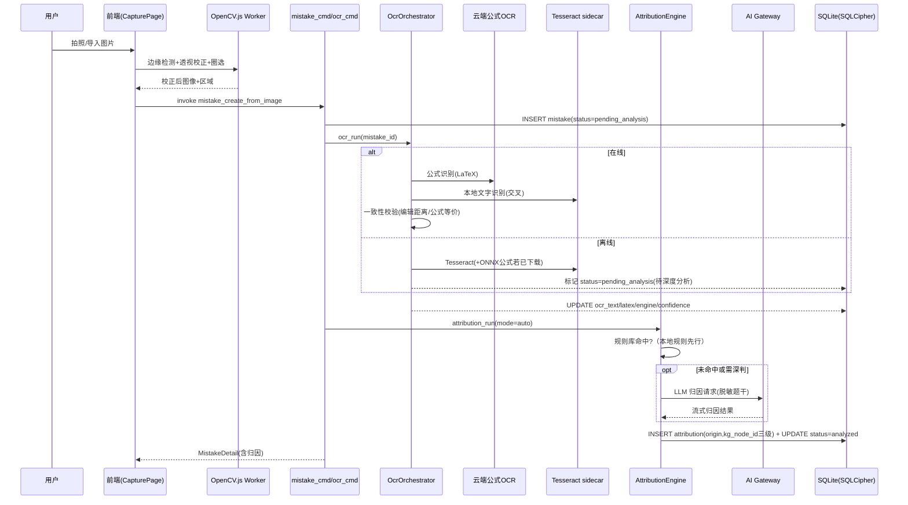
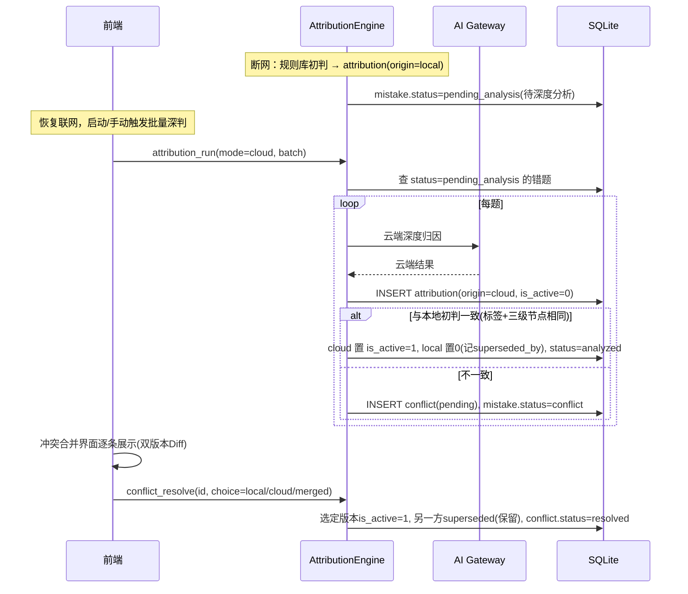
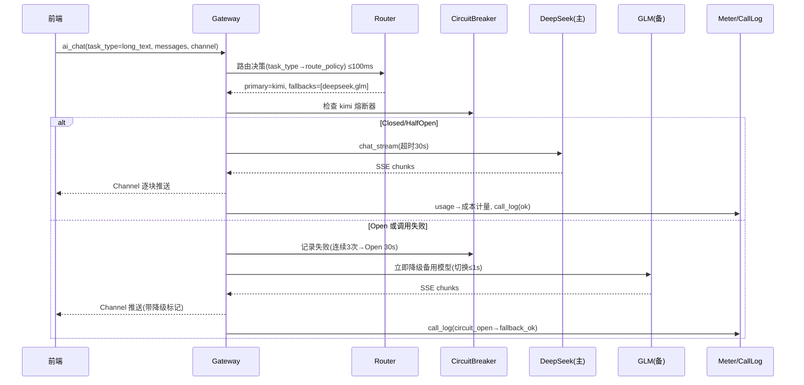
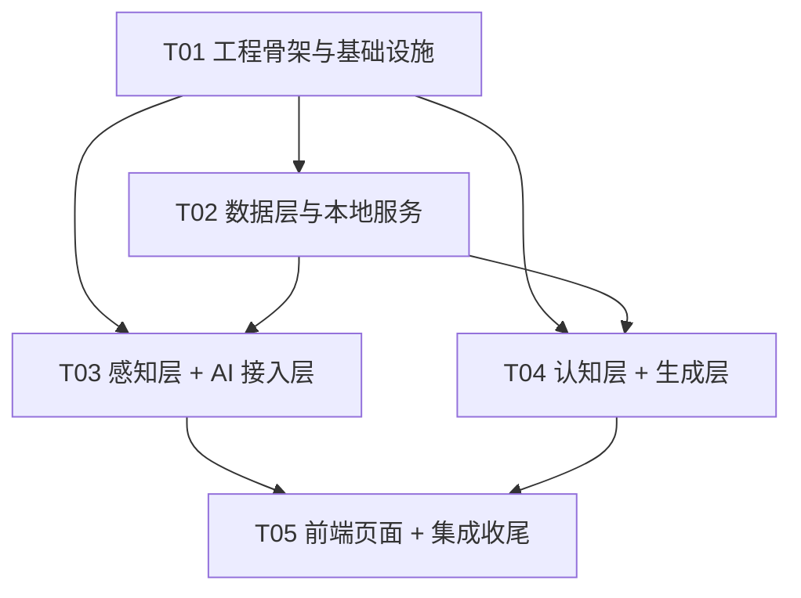

# 麦兜错题软件 系统架构设计文档

| 项目信息 | 内容 |
|---|---|
| 文档版本 | v1.0 |
| 架构师 | Bob（高见远） |
| 输入文档 | `docs/PRD.md` v1.0 |
| Language | 中文 |
| 技术栈 | Tauri 2.x + React 18 + TypeScript + Vite + SQLite（SQLCipher） |
| Project Name | `maiduo_cuotiben` |

---

## 1. 系统架构总览

### 1.1 设计要点与难点分析

| 难点 | 应对策略 |
|---|---|
| OCR 双引擎（云端公式识别 + 离线降级） | 引擎抽象为 `OcrEngine` trait；云端走 SimpleTex/Mathpix 类 API，离线用 Tesseract sidecar（文字）+ ONNX 公式模型（可选下载，`ort` 运行时）；双引擎结果做一致性比对 |
| 多模型统一接入（路由/熔断/流式/计量/密钥轮转） | Rust 侧实现 AI Gateway：适配器模式（OpenAI 兼容协议为基线，Hunyuan 签名单独适配），熔断器状态机，SSE 流式经 Tauri 2 `Channel` 桥接前端 |
| 生成题防幻觉（学科校验管道） | 三段管道：规则校验 → 符号计算验证（数学/物理，Python SymPy sidecar）→ LLM 自校验；任一闸不过则重生成或转人工复核 |
| 本地优先 + 隐私（加密、脱敏、断网可用） | rusqlite + `bundled-sqlcipher` 编译进二进制；密钥派生后存 OS 钥匙串（keyring）；结构化日志带 PII 打码层；所有云端调用收敛在 Gateway 单出口，便于断网降级与抓包审计 |
| 离线→在线冲突合并 | 归因结果带 `origin(local/cloud)` + 版本号；云端深判与本地初判不一致时写入 `conflict` 表并保留双版本，UI 弹合并界面 |
| 万级数据检索 ≤300ms | SQLite 索引设计 + FTS5 全文索引（题干），所有列表查询走分页 + 覆盖索引 |

### 1.2 五层架构图



### 1.3 Tauri 前后端职责划分

| 职责 | 前端（WebView） | Rust 核心 |
|---|---|---|
| UI/交互/可视化 | ✅ 全部页面、ECharts、KaTeX、拖拽圈选 | — |
| 图像预处理 | ✅ OpenCV.js：边缘检测、透视校正、圈选裁切 | 仅做格式转换/落盘（image crate） |
| OCR | — | ✅ 云端 API 调用 + Tesseract sidecar + ONNX 推理编排 |
| 数据库读写 | — | ✅ 唯一出口（rusqlite + SQLCipher） |
| AI 调用 | — | ✅ 唯一出口（Gateway），密钥不出 Rust 进程 |
| 业务算法 | — | ✅ 归因、掌握度、复习排程、校验管道 |
| 本地通知 | — | ✅ tauri-plugin-notification |
| 密钥存储 | — | ✅ OS 钥匙串（keyring crate） |

> 原则：**前端只做"看和点"，所有数据与外部 I/O 收敛在 Rust 侧**。这样隐私审计（AC-9 抓包验证）只需盯 Gateway 一个出口。

---

## 2. 技术选型明细

### 2.1 核心框架

| 层 | 选型 | 版本 | 理由 |
|---|---|---|---|
| 桌面壳 | Tauri | 2.x | 单代码库 Windows/macOS（N-05），二进制小，Rust 侧能力完整 |
| 前端 | React + TypeScript + Vite | 18.x / 5.x / 5.x | 团队基线 |
| UI 组件 | MUI + Tailwind CSS | @mui/material ^5.15 / tailwind ^3.4 | MUI 出复杂表单/表格，Tailwind 做布局微调 |
| 状态管理 | Zustand | ^4.5 | 轻量、无样板、易测试 |
| 图表 | ECharts | ^5.5 | 热力图/曲线/日历图一站覆盖（F-13） |
| 公式渲染 | KaTeX（react-katex） | ^0.9 | LaTeX 题干/答案渲染 |
| 图像处理 | @techstark/opencv-js | ^4.9 | 前端 WASM 边缘检测/透视校正，避免 Rust 链接 OpenCV 的跨平台编译地狱 |

### 2.2 Rust 侧关键选型

| 能力 | 选型 | 说明 |
|---|---|---|
| ORM/DB | rusqlite 0.31，feature = `bundled-sqlcipher-vendored-openssl` | SQLCipher 静态编译进二进制，无外部依赖；打开连接后首条语句 `PRAGMA key` |
| 迁移 | 自研轻量迁移器（`db/migrate.rs`，按版本号顺序执行 SQL） | 避免引入重型框架 |
| 全文检索 | SQLite FTS5（`mistake_fts` 虚表） | 万级题库检索 ≤300ms（AC-10） |
| HTTP/SSE | reqwest 0.12（rustls）+ `futures` stream | OpenAI 兼容流式解析 |
| Token 计量 | tiktoken-rs | 无 usage 字段时本地估算，成本误差 ≤1%（AC-7） |
| 钥匙串 | keyring 3.x | API Key 加密存 OS 钥匙串，支持版本化轮转 |
| 熔断 | 自研状态机（closed/open/half-open），`parking_lot` 锁 | 失败后即时切换备用链，满足 ≤1s SLA（N-06） |
| 离线 OCR 文字 | Tesseract sidecar 二进制（Tauri sidecar 机制随包分发） | 跨平台免编译 leptess |
| 离线公式识别 | `ort`（ONNX Runtime）+ 可选下载的小模型（pix2tex 类） | 模型按需下载，低端机优雅降级为"仅文字 OCR"（Q-2/Q-3） |
| 符号计算校验 | Python sidecar：PyInstaller 打包的 `mathverify`（SymPy）微服务（stdio JSON-RPC） | Rust 通过子进程 stdio 调用；sidecar 缺失时降级为 LLM 交叉验证并标记（Q-5） |
| 日志 | tracing + tracing-appender（滚动文件）+ 自研 PII 脱敏 Layer | N-03/N-07 |
| 通知 | tauri-plugin-notification | F-14 复习提醒 |
| 加密（E2E 同步预留） | aes-gcm | P1 用户自持密钥，服务端仅存密文 |

> **Q-5 拍板**：数学/物理用 SymPy sidecar 做符号验证（答案可解性、代入验证、量纲检查）；化学方程式用配平规则 + LLM 交叉验证；英语语法用规则 + LLM 双闸。sidecar 是独立可裁剪组件。

---

## 3. 数据模型设计（SQLite Schema）

### 3.1 ER 图



### 3.2 建表 SQL（核心）

```sql
-- 元信息与多档案（F-22 预留，首版默认单档案 id=1）
CREATE TABLE profile (
  id INTEGER PRIMARY KEY,
  name TEXT NOT NULL DEFAULT '默认档案',
  created_at TEXT NOT NULL DEFAULT (datetime('now'))
);

CREATE TABLE subject (
  id INTEGER PRIMARY KEY,
  code TEXT NOT NULL UNIQUE,           -- math/physics/chemistry/english
  name TEXT NOT NULL
);

-- 知识图谱（F-06/F-07）：节点+边，苏教版数学种子数据，框架兼容其他学科
CREATE TABLE kg_node (
  id INTEGER PRIMARY KEY,
  subject_id INTEGER NOT NULL REFERENCES subject(id),
  parent_id INTEGER REFERENCES kg_node(id),
  code TEXT NOT NULL,                  -- e.g. MATH.SX.FUNC.QUAD.MONO
  name TEXT NOT NULL,
  level INTEGER NOT NULL CHECK(level BETWEEN 1 AND 3),
  textbook TEXT NOT NULL DEFAULT 'sujiao',  -- 教材版本
  extra TEXT,                          -- JSON：说明/典型例题
  UNIQUE(subject_id, code)
);
CREATE TABLE kg_edge (
  id INTEGER PRIMARY KEY,
  subject_id INTEGER NOT NULL,
  from_node INTEGER NOT NULL REFERENCES kg_node(id),
  to_node INTEGER NOT NULL REFERENCES kg_node(id),
  relation TEXT NOT NULL DEFAULT 'prerequisite'  -- prerequisite/related
);
CREATE INDEX idx_kg_node_parent ON kg_node(parent_id);

-- 错题主表
CREATE TABLE mistake (
  id INTEGER PRIMARY KEY,
  profile_id INTEGER NOT NULL REFERENCES profile(id),
  subject_id INTEGER REFERENCES subject(id),
  source_image TEXT NOT NULL,          -- 原图相对路径（app_data_dir 下）
  processed_image TEXT,                -- 校正/裁切后图
  ocr_text TEXT,                       -- OCR 纯文本
  ocr_latex TEXT,                      -- 公式 LaTeX
  ocr_engine TEXT,                     -- cloud/tesseract/onnx/mixed
  ocr_confidence REAL,
  student_answer TEXT,
  correct_answer TEXT,
  chapter TEXT,
  question_type TEXT,                  -- 选择/填空/解答...
  difficulty INTEGER DEFAULT 3 CHECK(difficulty BETWEEN 1 AND 5),
  source TEXT,                         -- 来源（试卷/作业/自定义）
  status TEXT NOT NULL DEFAULT 'pending_analysis'
         CHECK(status IN ('pending_analysis','analyzing','analyzed','conflict','archived')),
  version INTEGER NOT NULL DEFAULT 1,  -- 乐观锁 + 冲突合并用
  created_at TEXT NOT NULL DEFAULT (datetime('now')),
  updated_at TEXT NOT NULL DEFAULT (datetime('now')),
  deleted INTEGER NOT NULL DEFAULT 0
);
CREATE INDEX idx_mistake_status ON mistake(status, deleted);
CREATE INDEX idx_mistake_subject ON mistake(subject_id, created_at DESC);
CREATE VIRTUAL TABLE mistake_fts USING fts5(ocr_text, content='mistake', content_rowid='id');
-- 触发器同步 FTS（insert/update/delete 各一）

-- 自定义标签（F-05）
CREATE TABLE tag (id INTEGER PRIMARY KEY, profile_id INTEGER NOT NULL,
                  name TEXT NOT NULL, color TEXT, UNIQUE(profile_id, name));
CREATE TABLE mistake_tag_rel (
  mistake_id INTEGER NOT NULL REFERENCES mistake(id),
  tag_id INTEGER NOT NULL REFERENCES tag(id),
  PRIMARY KEY(mistake_id, tag_id));

-- 错因归因（F-06）：多版本保留，支撑离线/在线冲突合并（AC-8）
CREATE TABLE attribution (
  id INTEGER PRIMARY KEY,
  mistake_id INTEGER NOT NULL REFERENCES mistake(id),
  origin TEXT NOT NULL CHECK(origin IN ('local','cloud','user')),  -- 本地初判/云端深判/人工
  engine TEXT NOT NULL,                -- rule/llm/merged/manual
  cause_label TEXT NOT NULL,           -- 错因标签，如「对称轴与区间位置关系理解偏差」
  cause_detail TEXT,                   -- 可解释说明
  kg_node_id INTEGER REFERENCES kg_node(id),  -- 三级节点定位
  confidence REAL NOT NULL DEFAULT 0,
  is_active INTEGER NOT NULL DEFAULT 1,-- 当前生效版本
  superseded_by INTEGER,               -- 被哪条替代（保留双版本）
  created_at TEXT NOT NULL DEFAULT (datetime('now'))
);
CREATE INDEX idx_attr_mistake ON attribution(mistake_id, is_active);

-- 冲突表（F-16）
CREATE TABLE conflict (
  id INTEGER PRIMARY KEY,
  entity_type TEXT NOT NULL DEFAULT 'attribution',
  entity_id INTEGER NOT NULL,          -- 关联 mistake.id
  local_attr_id INTEGER NOT NULL REFERENCES attribution(id),
  cloud_attr_id INTEGER NOT NULL REFERENCES attribution(id),
  status TEXT NOT NULL DEFAULT 'pending' CHECK(status IN ('pending','resolved','ignored')),
  resolved_choice TEXT,                -- local/cloud/merged
  created_at TEXT NOT NULL DEFAULT (datetime('now')),
  resolved_at TEXT
);

-- 变式题（F-08/F-09）
CREATE TABLE variant_question (
  id INTEGER PRIMARY KEY,
  mistake_id INTEGER NOT NULL REFERENCES mistake(id),
  kg_node_id INTEGER REFERENCES kg_node(id),
  content TEXT NOT NULL,
  content_latex TEXT,
  answer TEXT NOT NULL,
  solution TEXT,
  difficulty INTEGER NOT NULL DEFAULT 3,
  variant_type TEXT NOT NULL DEFAULT 'isomorphic',  -- isomorphic(同构)/recontext(异景)/advanced(递进)
  generator_model TEXT,                -- 生成所用模型
  validate_status TEXT NOT NULL DEFAULT 'pending'
         CHECK(validate_status IN ('pending','passed','failed','manual_review')),
  validate_detail TEXT,                -- JSON：三道闸各自结果
  created_at TEXT NOT NULL DEFAULT (datetime('now'))
);
CREATE INDEX idx_variant_mistake ON variant_question(mistake_id, validate_status);

-- 作答记录（驱动掌握度与复习排程）
CREATE TABLE attempt (
  id INTEGER PRIMARY KEY,
  profile_id INTEGER NOT NULL,
  target_type TEXT NOT NULL CHECK(target_type IN ('mistake','variant')),
  target_id INTEGER NOT NULL,
  answer TEXT,
  is_correct INTEGER NOT NULL,
  duration_ms INTEGER,
  created_at TEXT NOT NULL DEFAULT (datetime('now'))
);
CREATE INDEX idx_attempt_target ON attempt(target_type, target_id);

-- 掌握度（F-15）：每档案×知识节点一行，EMA 更新
CREATE TABLE mastery (
  id INTEGER PRIMARY KEY,
  profile_id INTEGER NOT NULL,
  kg_node_id INTEGER NOT NULL REFERENCES kg_node(id),
  score REAL NOT NULL DEFAULT 0,       -- 0~1
  attempts INTEGER NOT NULL DEFAULT 0,
  correct INTEGER NOT NULL DEFAULT 0,
  last_assessed_at TEXT,
  UNIQUE(profile_id, kg_node_id)
);
CREATE TABLE mastery_history (          -- 掌握度曲线（F-13）
  id INTEGER PRIMARY KEY,
  profile_id INTEGER NOT NULL,
  kg_node_id INTEGER NOT NULL,
  score REAL NOT NULL,
  created_at TEXT NOT NULL DEFAULT (datetime('now'))
);

-- 复习计划（F-14）：类艾宾浩斯，间隔可配置
CREATE TABLE review_config (
  profile_id INTEGER PRIMARY KEY,
  intervals TEXT NOT NULL DEFAULT '[1,3,7,15,30]'  -- JSON，天数
);
CREATE TABLE review_plan (
  id INTEGER PRIMARY KEY,
  profile_id INTEGER NOT NULL,
  target_type TEXT NOT NULL CHECK(target_type IN ('mistake','variant')),
  target_id INTEGER NOT NULL,
  stage INTEGER NOT NULL DEFAULT 0,    -- 当前处于 intervals 第几级
  next_due_at TEXT NOT NULL,
  status TEXT NOT NULL DEFAULT 'pending' CHECK(status IN ('pending','done','skipped','expired')),
  completed_at TEXT,
  created_at TEXT NOT NULL DEFAULT (datetime('now'))
);
CREATE INDEX idx_review_due ON review_plan(profile_id, status, next_due_at);

-- OCR 任务（双引擎结果与一致性比对留痕）
CREATE TABLE ocr_job (
  id INTEGER PRIMARY KEY,
  mistake_id INTEGER REFERENCES mistake(id),
  engine TEXT NOT NULL,                -- cloud/tesseract/onnx
  status TEXT NOT NULL DEFAULT 'pending',
  result_text TEXT, result_latex TEXT, confidence REAL,
  latency_ms INTEGER,
  created_at TEXT NOT NULL DEFAULT (datetime('now'))
);

-- 模型接入（F-10/F-11/F-19）
CREATE TABLE model_provider (
  id INTEGER PRIMARY KEY,
  name TEXT NOT NULL,                  -- deepseek/hunyuan/glm/kimi/local
  protocol TEXT NOT NULL DEFAULT 'openai_compat',
  base_url TEXT NOT NULL,
  key_alias TEXT NOT NULL,             -- 指向 keyring 中的别名，不存明文
  models TEXT NOT NULL,                -- JSON: [{id, price_in, price_out, ctx}]
  enabled INTEGER NOT NULL DEFAULT 1,
  priority INTEGER NOT NULL DEFAULT 0,
  created_at TEXT NOT NULL DEFAULT (datetime('now'))
);
CREATE TABLE route_policy (
  id INTEGER PRIMARY KEY,
  task_type TEXT NOT NULL UNIQUE,      -- ocr_attribution/variant_gen/long_text/vision...
  primary TEXT NOT NULL,               -- provider.model
  fallbacks TEXT NOT NULL DEFAULT '[]',-- JSON 备用链
  timeout_ms INTEGER NOT NULL DEFAULT 30000,
  max_cost_cny REAL,                   -- 单次成本上限
  monthly_budget_cny REAL              -- 月度预算（F-19）
);
CREATE TABLE call_log (                -- 成本计量 + 脱敏日志（AC-7/AC-9）
  id INTEGER PRIMARY KEY,
  provider TEXT NOT NULL, model TEXT NOT NULL,
  task_type TEXT NOT NULL,
  tokens_in INTEGER DEFAULT 0, tokens_out INTEGER DEFAULT 0,
  cost_cny REAL DEFAULT 0,
  latency_ms INTEGER, status TEXT NOT NULL,  -- ok/timeout/error/circuit_open
  error_code TEXT, request_hash TEXT,        -- 内容仅存哈希+脱敏摘要
  created_at TEXT NOT NULL DEFAULT (datetime('now'))
);
CREATE INDEX idx_calllog_time ON call_log(created_at);

-- 同步预留（F-21）与应用元信息
CREATE TABLE sync_meta (key TEXT PRIMARY KEY, value TEXT);
CREATE TABLE app_meta (key TEXT PRIMARY KEY, value TEXT);  -- schema_version 等
```

### 3.3 数据层关键设计说明

1. **SQLCipher 集成**：`Connection::open` 后立即执行 `PRAGMA key = '<derived>'`；密钥 = 用户口令（首次启动随机生成）经 Argon2 派生，派生结果存 OS 钥匙串，明文口令不落盘。
2. **备份（N-04）**：每日启动后后台任务将 DB 文件复制到 `backups/maiduo-YYYYMMDD.db`（密文复制），保留最近 7 份滚动删除；提供 `backup.restore` 命令。
3. **冲突合并（Q-7 拍板）**：归因采用**版本化 + 用户裁决**（非 last-write-wins）：本地初判与云端深判并存为两条 `attribution`（`origin` 区分），不一致即生成 `conflict` 记录，用户确认后一方 `is_active=0` 并记 `superseded_by`，双版本永久保留（AC-8）。
4. **知识图谱种子数据**：`src-tauri/resources/kg_seed/math_sujiao.json`（苏教版 K12 数学主干，三级），首次启动导入；物理/化学/英语仅建空 subject 占位与框架（用户拍板：其他学科预留）。

---

## 4. 接口契约

### 4.1 Tauri Command 清单（前端 invoke API）

> 统一返回 `Result<T, AppError>`；`AppError` 序列化为 `{code, message, detail?}`。流式接口使用 Tauri 2 `ipc::Channel<StreamChunk>` 参数。

| 模块 | Command | 参数 → 返回 | 说明 |
|---|---|---|---|
| 错题 | `mistake_create_from_image` | `{image_path, region?}` → `Mistake` | 入库并触发 OCR 流水线（F-01/02） |
| 错题 | `mistake_list` | `MistakeQuery` → `Page<MistakeSummary>` | 多维筛选+FTS 搜索+分页（F-05） |
| 错题 | `mistake_get` / `mistake_update` / `mistake_delete` | id → `MistakeDetail` | 详情含归因/变式/复习记录 |
| OCR | `ocr_run` | `{mistake_id, prefer}` → `OcrResult` | 双引擎编排+一致性校验（F-04） |
| 归因 | `attribution_run` | `{mistake_id, mode: local\|cloud}` → `Attribution` | 规则+LLM 双驱动（F-06） |
| 归因 | `attribution_confirm` | `{attribution_id, edited?}` → `()` | 用户认可/修改（G2 指标埋点） |
| 冲突 | `conflict_list` / `conflict_resolve` | → `[Conflict]` / `{id, choice}` | 合并界面（F-16，AC-8） |
| 变式 | `variant_generate` | `{mistake_id, count, channel}` → `Channel` 流式 `[VariantDraft]` | 生成+校验管道（F-08/09） |
| 变式 | `variant_submit_attempt` | `{variant_id, answer}` → `{is_correct, feedback, mastery_delta}` | 作答反馈闭环（F-15） |
| 图谱 | `kg_tree` / `kg_search` | subject_id → `KgTree` | 三级图谱 |
| 报告 | `mastery_report` | `{profile_id, range}` → `ReportDto` | 热力图/曲线/错因分布（F-13） |
| 复习 | `review_today` / `review_complete` | → `[ReviewItem]` / `{plan_id, is_correct}` | 今日队列+排程推进（F-14） |
| 模型 | `model_provider_list/upsert/test` | → `[Provider]` | 配置与连通性测试（F-11） |
| 模型 | `route_policy_list/upsert` | → `[RoutePolicy]` | 路由规则自定义（F-19） |
| 模型 | `ai_chat` | `{task_type, messages, channel}` → 流式 | 统一聊天入口（走 Gateway） |
| 统计 | `cost_stats` | `{range}` → `CostReport` | 成本面板（F-19） |
| 系统 | `settings_get/set`、`backup_run/list/restore`、`log_clear` | | N-04/N-03 |
| 同步 | `sync_push/pull`（P1 桩） | | E2E 加密同步预留 |

### 4.2 多模型接入层统一接口

```rust
/// 适配器模式：OpenAI 兼容为基线协议
#[async_trait]
trait ProviderAdapter {
    async fn chat_stream(&self, req: ChatRequest) -> Result<ChatStream, AppError>;
    async fn chat_once(&self, req: ChatRequest)  -> Result<ChatResponse, AppError>;
    fn estimate_tokens(&self, text: &str) -> u32;     // tiktoken
    fn pricing(&self, model: &str) -> Option<Price>;  // 分/千token
}

struct Gateway {
    router: Router,               // 按 task_type 查 route_policy，决策 ≤100ms
    breakers: DashMap<String, CircuitBreaker>, // 每个 provider.model 一个熔断器
    meter: Meter,                 // 成本计量写 call_log
    keychain: Keychain,           // keyring 读写 + 版本化轮转
}

enum CircuitState { Closed, Open{until: Instant}, HalfOpen }
// 触发：连续3次失败或超时→Open(冷却30s)→HalfOpen(单探测)→Closed
// Open 期间请求即时落到 fallbacks 链 → 切换延迟 ≤1s（N-06）
```

**路由策略**：`task_type`（归因/变式生成/长文本/视觉）→ 查 `route_policy`（primary + fallbacks 链 + 超时 + 成本上限）→ 检查熔断器 → 调用 → 失败即沿链降级并写 `call_log(status='circuit_open')`。

**密钥轮转**：`key_alias` 指向 keyring 条目 `maiduo/{alias}`，轮转 = 写入 `maiduo/{alias}/v{n+1}` 并更新指针，旧版本保留至下次成功调用后删除；密钥永不离开 Rust 进程、永不回传（隐私要求 7）。

**流式桥接**：适配器产出 `ChatStream = impl Stream<Item=StreamChunk>`；Command 层将其逐块推入 `Channel<StreamChunk>`，前端 `onmessage` 增量渲染（StreamMarkdown 组件）。

### 4.3 核心类图（数据模型与服务关系）



### 4.4 核心数据结构（TS 侧镜像）

```ts
interface StreamChunk { delta: string; done: boolean; usage?: {in:number;out:number}; }
interface Attribution { id:number; origin:'local'|'cloud'|'user'; cause_label:string;
  cause_detail?:string; kg_node_id?:number; kg_path?:string[]; confidence:number; }
interface VariantDraft { content:string; content_latex?:string; answer:string;
  solution?:string; difficulty:number; variant_type:string;
  validate_status:'pending'|'passed'|'failed'|'manual_review'; }
```

---

## 5. 核心流程时序图

### 5.1 拍照录入 → OCR → 归因 → 入库（场景 A 前半段）



### 5.2 自适应出题 + 学科校验（场景 A 后半段）

```mermaid
sequenceDiagram
    participant FE as 前端(TrainPage)
    participant V as VariantGenerator
    participant T as 模板库
    participant GW as AI Gateway
    participant VP as 校验管道
    participant SY as SymPy sidecar
    participant DB as SQLite

    FE->>V: variant_generate(mistake_id,count=2,channel)
    V->>T: 匹配同构模板(按kg_node+题型)
    V->>GW: LLM 生成(同构巩固+递进提升, 含答案与解析)
    GW-->>V: 流式草稿 VariantDraft
    loop 每道草稿
        V->>VP: validate(draft)
        VP->>VP: 闸1 规则校验(题型完整/数值合理/敏感内容)
        VP->>SY: 闸2 符号验证(答案可解性/代入验证) [数学/物理]
        SY-->>VP: pass/fail+依据
        VP->>GW: 闸3 LLM 自校验(另一模型交叉判题)
        GW-->>VP: pass/fail
        alt 全部通过
            VP->>DB: INSERT variant(validate_status=passed)
        else 失败≤2次
            VP->>GW: 携带失败原因重生成
        else 仍失败
            VP->>DB: INSERT variant(validate_status=manual_review)
        end
        V-->>FE: channel 推送(含校验状态)
    end
    FE->>V: variant_submit_attempt(answer)
    V->>DB: INSERT attempt; UPDATE mastery(EMA); UPSERT review_plan(1/3/7/15)
    V-->>FE: {is_correct, feedback, mastery_delta}
```

### 5.3 离线 → 在线冲突合并（场景 C）



### 5.4 多模型路由 + 熔断（场景 D）



---

## 6. 文件列表（目录树）

```
maiduo_cuotiben/
├── package.json                    # npm 依赖与脚本
├── vite.config.ts                  # Vite 配置（含 Tauri 集成）
├── tsconfig.json                   # TS 配置
├── tailwind.config.js              # Tailwind 配置
├── postcss.config.js               # PostCSS 配置
├── index.html                      # SPA 入口
├── src/
│   ├── main.tsx                    # React 挂载入口
│   ├── App.tsx                     # 路由与全局布局
│   ├── theme.ts                    # MUI 主题（中文排版/暗色）
│   ├── styles/index.css            # Tailwind 入口 + 全局样式
│   ├── types/index.ts              # 全部 TS 类型（与 Rust DTO 镜像）
│   ├── api/                        # invoke 封装（一模块一文件）
│   │   ├── client.ts               # invoke 包装 + 统一错误处理 + Channel 封装
│   │   ├── mistake.ts / ocr.ts / attribution.ts / variant.ts
│   │   ├── kg.ts / mastery.ts / review.ts / model.ts / settings.ts
│   ├── stores/                     # Zustand 状态
│   │   ├── appStore.ts             # 在线状态/档案/全局通知
│   │   ├── mistakeStore.ts         # 错题列表/详情/筛选
│   │   ├── trainStore.ts           # 训练作答/流式生成状态
│   │   ├── reportStore.ts          # 报告数据缓存
│   │   └── settingsStore.ts        # 模型/路由/系统设置
│   ├── pages/
│   │   ├── HomePage.tsx            # 今日面板（复习任务/待分析/薄弱预警）
│   │   ├── CapturePage.tsx         # 拍照录入（边缘检测/校正/圈选）
│   │   ├── ImportPage.tsx          # 相册/PDF 导入
│   │   ├── MistakeListPage.tsx     # 错题本列表+多维筛选+标签
│   │   ├── MistakeDetailPage.tsx   # 错题详情（原图/OCR/归因/变式/复习）
│   │   ├── TrainPage.tsx           # 今日训练（变式作答+即时反馈）
│   │   ├── PaperPage.tsx           # 组卷打印（P1，先留路由骨架）
│   │   ├── ReportPage.tsx          # 诊断报告（热力图/曲线/日历）
│   │   ├── ModelSettingsPage.tsx   # 模型接入/路由策略/成本面板
│   │   ├── SystemSettingsPage.tsx  # 同步/备份/隐私/多档案
│   │   └── ConflictMergePage.tsx   # 冲突合并（双版本 Diff）
│   ├── components/
│   │   ├── ImageCropper.tsx        # OpenCV 圈选与四角拖拽校正
│   │   ├── OcrResultEditor.tsx     # OCR 结果可编辑（文本+LaTeX 预览）
│   │   ├── LatexText.tsx           # KaTeX 渲染封装
│   │   ├── StreamMarkdown.tsx      # 流式增量渲染
│   │   ├── KgHeatmap.tsx           # 知识薄弱热力图（ECharts）
│   │   ├── MasteryChart.tsx        # 掌握度曲线
│   │   ├── ReviewCalendar.tsx      # 复习计划日历
│   │   ├── TagPicker.tsx           # 标签选择/自定义
│   │   ├── ConflictDiff.tsx        # 冲突双版本对比组件
│   │   └── ModelRouteForm.tsx      # 路由策略表单
│   ├── workers/cv.worker.ts        # OpenCV.js WASM 图像处理 Worker
│   └── utils/                      # format.ts / pii.ts(前端脱敏辅助) / download.ts
├── src-tauri/
│   ├── Cargo.toml                  # cargo 依赖
│   ├── tauri.conf.json             # Tauri 配置（窗口/权限/sidecar 声明）
│   ├── build.rs
│   ├── resources/
│   │   └── kg_seed/math_sujiao.json  # 苏教版数学三级图谱种子数据
│   ├── tools/mathverify/main.py    # SymPy 校验 sidecar 源码（stdio JSON-RPC）
│   └── src/
│       ├── main.rs                 # 入口：Builder、插件、State 注入
│       ├── lib.rs                  # 命令注册、启动任务(备份/复习扫描)
│       ├── error.rs                # AppError + 统一错误码
│       ├── logging.rs              # tracing 初始化 + PII 脱敏 Layer
│       ├── backup.rs               # 每日备份(7份)/恢复
│       ├── commands/               # Tauri Commands（一模块一文件）
│       │   ├── mod.rs / mistake_cmd.rs / ocr_cmd.rs / attribution_cmd.rs
│       │   ├── variant_cmd.rs / kg_cmd.rs / mastery_cmd.rs
│       │   ├── review_cmd.rs / model_cmd.rs / settings_cmd.rs / sync_cmd.rs
│       ├── db/
│       │   ├── mod.rs              # 连接池 + SQLCipher PRAGMA + 密钥派生
│       │   ├── migrate.rs          # 版本化迁移器
│       │   └── dao/                # mistake/attribution/variant/kg/mastery/review/model/log 各一个 DAO
│       ├── ocr/
│       │   ├── mod.rs              # OcrEngine trait + 编排器(双引擎/一致性)
│       │   ├── cloud_ocr.rs        # SimpleTex/Mathpix 类适配
│       │   ├── tesseract_ocr.rs    # Tesseract sidecar 调用
│       │   ├── onnx_formula.rs     # ort ONNX 公式识别（可选下载）
│       │   └── preprocess.rs       # 图像格式转换/落盘
│       ├── ai/
│       │   ├── mod.rs              # Gateway 主结构
│       │   ├── adapter.rs          # ProviderAdapter trait + ChatRequest/Stream
│       │   ├── router.rs           # 任务类型路由(≤100ms)
│       │   ├── circuit_breaker.rs  # 熔断状态机(≤1s 切换)
│       │   ├── meter.rs            # token 估算 + 成本计量
│       │   ├── keychain.rs         # keyring 密钥管理/轮转
│       │   ├── stream.rs           # SSE 解析 → Channel
│       │   └── providers/
│       │       ├── openai_compat.rs # DeepSeek/GLM/Kimi/本地端侧 通用适配
│       │       └── hunyuan.rs      # 混元签名适配
│       ├── attribution/
│       │   ├── mod.rs              # 归因引擎(规则优先→LLM 深判→合并)
│       │   ├── rules.rs            # 规则库(学科规则, 首批数学50-100条)
│       │   └── prompts.rs          # 归因/自校验提示词模板
│       ├── kg/
│       │   ├── mod.rs              # 图谱查询/三级定位/路径组装
│       │   └── seed_loader.rs      # 种子数据导入
│       ├── mastery/mod.rs          # 掌握度 EMA 模型 + 历史快照
│       ├── review/
│       │   ├── mod.rs              # 类艾宾浩斯排程(可配置间隔/答错重置)
│       │   └── notify.rs           # 到期本地通知
│       ├── variant/
│       │   ├── mod.rs              # 变式生成编排(模板+LLM)
│       │   ├── templates.rs        # 出题模板库(同构/异景/递进)
│       │   └── validate/
│       │       ├── mod.rs          # 三段校验管道编排(重试≤2次→人工复核)
│       │       ├── rules.rs        # 闸1 规则校验(含敏感内容)
│       │       ├── symbolic.rs     # 闸2 SymPy sidecar stdio 客户端
│       │       └── llm_check.rs    # 闸3 LLM 交叉自校验
│       ├── sync/mod.rs             # P1 桩：E2E 加密同步接口定义
│       └── crypto/mod.rs           # AES-GCM 加解密(同步/备份用)
└── docs/
    ├── PRD.md
    └── ARCHITECTURE.md             # 本文档
```

---

## 7. 任务列表（按依赖排序，≤5 批）

> 每批内部按文件顺序实现；批间仅保留必要依赖，T02/T03/T04 在 T01 完成后可并行推进。

| Task ID | 任务名 | 源文件（创建/修改） | 依赖 | 优先级 |
|---|---|---|---|---|
| **T01** | 工程骨架与基础设施 | `package.json`、`vite.config.ts`、`tsconfig.json`、`tailwind.config.js`、`postcss.config.js`、`index.html`、`src/main.tsx`、`src/App.tsx`、`src/theme.ts`、`src/styles/index.css`、`src-tauri/Cargo.toml`、`src-tauri/tauri.conf.json`、`src-tauri/build.rs`、`src-tauri/src/main.rs`、`src-tauri/src/lib.rs`、`src-tauri/src/error.rs`、`src-tauri/src/logging.rs` | — | P0 |
| **T02** | 数据层与本地服务 | `src-tauri/src/db/mod.rs`、`db/migrate.rs`、`db/dao/*`（8 个 DAO）、`src-tauri/src/backup.rs`、`src-tauri/src/crypto/mod.rs`、`src-tauri/src/ai/keychain.rs`、`src-tauri/resources/kg_seed/math_sujiao.json`、`src-tauri/src/kg/seed_loader.rs`、`src-tauri/src/kg/mod.rs`、`src-tauri/src/sync/mod.rs`（桩）、`src-tauri/src/commands/settings_cmd.rs`、`commands/kg_cmd.rs` | T01 | P0 |
| **T03** | 感知层 + AI 接入层 | `src-tauri/src/ocr/*`（5 文件）、`src-tauri/src/ai/*`（mod/adapter/router/circuit_breaker/meter/stream/providers 共 8 文件）、`src-tauri/src/commands/ocr_cmd.rs`、`commands/model_cmd.rs`、`src/workers/cv.worker.ts`、`src/components/ImageCropper.tsx` | T01、T02 | P0 |
| **T04** | 认知层 + 生成层（业务内核） | `src-tauri/src/attribution/*`（3 文件）、`src-tauri/src/mastery/mod.rs`、`src-tauri/src/review/*`（2 文件）、`src-tauri/src/variant/*`（6 文件含 validate）、`src-tauri/tools/mathverify/main.py`、`src-tauri/src/commands/attribution_cmd.rs`、`commands/variant_cmd.rs`、`commands/mastery_cmd.rs`、`commands/review_cmd.rs`、`commands/mistake_cmd.rs` | T01、T02 | P0 |
| **T05** | 前端全部页面 + 集成收尾 | `src/types/index.ts`、`src/api/*`（10 文件）、`src/stores/*`（5 文件）、`src/pages/*`（11 页面）、`src/components/*`（除 ImageCropper 外 9 组件）、`src/utils/*`；联调：AC-1~AC-10 验收、性能（冷启动/检索）、隐私抓包、打包（sidecar 捆绑） | T02、T03、T04 | P0 |

**原 10 模块批次映射**：T1 骨架→T01；T2 数据库→T02；T3 OCR + T4 多模型接入→T03；T5 归因 + T6 图谱/掌握度 + T7 出题校验 + T9 复习排程→T04；T8 UI + T10 集成→T05。

### 任务依赖图



---

## 8. 依赖包清单

### 8.1 npm（package.json）

```text
- react@^18.3.1 / react-dom@^18.3.1        # UI
- react-router-dom@^6.26.0                 # 路由
- @mui/material@^5.16.0 / @mui/icons-material@^5.16.0
- @emotion/react@^11.13.0 / @emotion/styled@^11.13.0   # MUI 依赖
- tailwindcss@^3.4.10 / postcss@^8.4.41 / autoprefixer@^10.4.20
- zustand@^4.5.5                           # 状态管理
- echarts@^5.5.1                           # 热力图/曲线/日历
- katex@^0.16.11 / react-katex@^3.0.1      # LaTeX 渲染
- @techstark/opencv-js@^4.9.0              # 前端图像处理(WASM)
- @tauri-apps/api@^2.0.0                   # invoke/Channel/event
- @tauri-apps/plugin-dialog@^2.0.0         # 文件选择
- @tauri-apps/plugin-notification@^2.0.0   # 复习提醒(前端触发侧)
- dayjs@^1.11.13                           # 日期处理
- 开发: vite@^5.4.0, @vitejs/plugin-react@^4.3.1, typescript@^5.5.4,
        @tauri-apps/cli@^2.0.0, vitest@^2.0.5
```

### 8.2 cargo（src-tauri/Cargo.toml）

```text
- tauri@2.x                                # 桌面框架
- tauri-plugin-dialog@2 / tauri-plugin-notification@2 / tauri-plugin-fs@2
- rusqlite@0.31 (features=["bundled-sqlcipher-vendored-openssl"])  # SQLCipher
- serde@1 / serde_json@1                   # DTO 序列化
- tokio@1 (rt-multi-thread, macros, time)  # 异步运行时
- reqwest@0.12 (rustls-tls, stream, json)  # HTTPS/SSE
- futures@0.3 / async-stream@0.3           # 流处理
- async-trait@0.1                          # ProviderAdapter trait
- tiktoken-rs@0.6                          # token 计量
- keyring@3                                # OS 钥匙串(API Key)
- tracing@0.1 / tracing-subscriber@0.3 / tracing-appender@0.2   # 结构化日志
- image@0.25 / imageproc@0.25              # 图像落盘/基础处理
- ort@2.0.0-rc (optional)                  # ONNX 公式识别(可选下载模型)
- argon2@0.5                               # DB 密钥派生
- aes-gcm@0.10 / base64@0.22               # E2E 同步加密预留
- anyhow@1 / thiserror@1                   # 错误处理
- uuid@1 / chrono@0.4                      # ID/时间
- once_cell@1 / parking_lot@0.12 / dashmap@6  # 并发容器(熔断器表)
- regex@1                                  # PII 脱敏/规则库
```

---

## 9. 共享知识（跨文件约定）

1. **错误码**：`AppError{code,message,detail?}`；code 段分配：`1xxx` 通用/参数，`2xxx` 数据库，`3xxx` OCR，`4xxx` AI 接入层（`4001` 全链路熔断不可用、`4002` 预算超限），`5xxx` 归因/校验，`6xxx` 同步。前端 `api/client.ts` 统一 unwrap 并弹错。
2. **API 返回**：Command 一律 `Result<T, AppError>`，不出现裸 `String` 错误。
3. **命名**：DB 表/列 snake_case；TS 类型字段 camelCase（serde `rename_all="camelCase"`）；Command 名 `模块_动作` 蛇形；文件 kebab/snake 按上述目录树。
4. **时间**：全部存 ISO 8601 UTC 字符串（`datetime('now')`），前端 dayjs 转本地时区展示。
5. **状态管理**：Zustand 按域拆 store；服务端数据不复制进全局 store，列表页本地 state + `reportStore/trainStore` 只存会话态；流式数据走 ref 增量，避免高频 setState。
6. **流式桥接**：Rust 侧每个流式 Command 接收 `tauri::ipc::Channel<StreamChunk>`；前端封装 `invokeStream(cmd, args, onChunk)`；**禁止用全局 event 做流式**（Channel 类型安全且定向）。
7. **隐私红线**：PII 脱敏在 Rust `logging.rs` 的 tracing Layer 统一执行（手机号/姓名/学校正则打码）；`call_log` 只存 `request_hash` + 脱敏摘要，不存完整 prompt；任何新增外发请求**必须经 `ai/Gateway`**，违者 Code Review 打回（AC-9 抓包验证依据）。
8. **离线判定**：`appStore` 监听 `tauri event online/offline` + Gateway 探测双信号；离线时 UI 展示「本地模式」徽章，云端命令自动切本地路径。
9. **可测试性**：DAO/引擎均依赖 trait 注入连接，单元测试用内存 SQLite（`:memory:` + 同样 PRAGMA）；校验管道的 SymPy sidecar 可 mock 为固定 JSON 响应。

---

## 10. 待明确事项（假设已注明）

| # | 事项 | 当前假设/处置 |
|---|---|---|
| U-1 | 苏教版数学图谱种子数据的教研来源与规模 | 假设由 PM/教研提供三级节点清单（Q-1 已拍板苏教版），架构提供 JSON 导入器，首版种子覆盖函数/几何/代数主干约 200 节点 |
| U-2 | Tesseract 中文手写识别精度有限 | 按 PRD 接受差异：离线仅做"初级归类"，深判留给联网（场景 C 机制兜底） |
| U-3 | SimpleTex/Mathpix 具体供应商与成本 | 接口按 OpenAI 式适配器抽象，供应商配置化（base_url+key），二选一由 PM 商务确认；`cloud_ocr.rs` 结构不变 |
| U-4 | ONNX 公式模型的具体模型选型与授权 | 预留 `onnx_formula.rs` 可插拔，首版可仅打包 Tesseract，公式离线识别为可选下载项（Q-3 已拍板接受精度差异） |
| U-5 | SymPy sidecar 打包体积（PyInstaller ≈40MB） | 作为**可选组件**分发：缺失时闸 2 降级为 LLM 交叉验证并在 `validate_detail` 标记 `symbolic=skipped`；安装器提供"完整版/轻量版" |
| U-6 | PDF 整卷批量拆题 | 按 Q-6 拍板 P0 仅单页导入，整卷拆题 P1，`ImportPage` 留扩展位 |
| U-7 | 云同步服务端（F-21 P1） | 首版仅 `sync/mod.rs` 接口桩 + `sync_meta` 表，不实现服务端 |

---

*本文档为工程师实现的唯一架构依据；与 PRD 冲突时以用户已拍板决策为准。*
