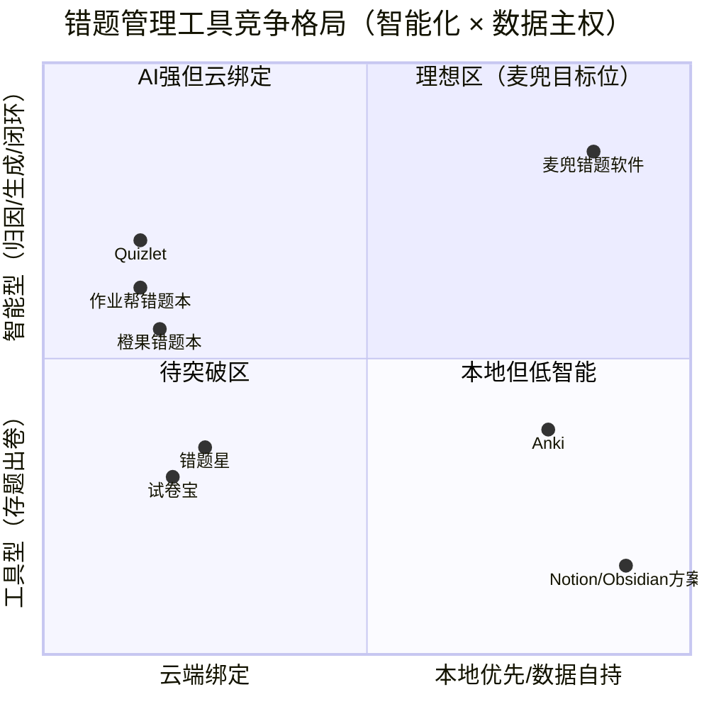
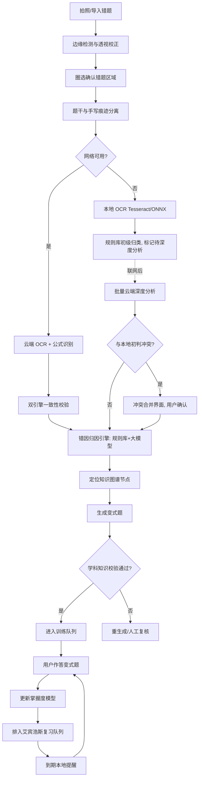
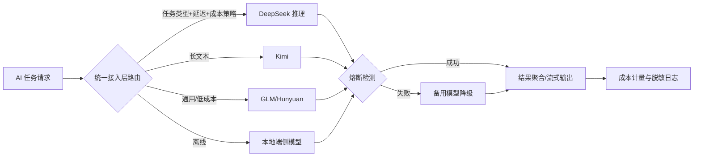

# 麦兜错题软件 产品需求文档（PRD）

| 项目信息 | 内容 |
|---|---|
| 文档版本 | v1.0（完整功能版） |
| 产品经理 | Alice（许清楚） |
| Language | 中文 |
| Programming Language | Tauri + React（TypeScript）+ SQLite，桌面端优先，本地优先（Local-First） |
| Project Name | `maiduo_cuotiben` |
| 文档状态 | 已评审输入，待架构师系统设计 |

## 原始需求复述

用户需要一款**可自主部署、本地优先**的智能错题管理应用，形成学习闭环：学习者拍照/导入错题 → 自动识别归档 → 错因深度分析 → 知识薄弱图谱 → 自适应生成相似训练题 → 复习提醒闭环。要求支持多学科（数理化英等）、OCR 在线/离线双引擎、规则库+大模型双驱动归因、多模型统一接入层（OpenAI 兼容、智能路由、熔断降级）、SQLite 本地存储、端到端加密与日志脱敏、可视化诊断报告与类艾宾浩斯复习计划。

---

## 1. 产品概述

### 1.1 产品定位

**麦兜错题软件**是一款「本地优先 + AI 驱动」的桌面端智能错题管理与自适应训练工具。与市面上云端绑定的错题 App 不同，麦兜把**数据主权交还给用户**：所有错题、笔记、掌握度模型默认存储在本地 SQLite，AI 能力通过统一的多模型接入层按需调用，断网时自动降级到离线 OCR 与规则引擎，核心流程永不断线。

### 1.2 产品目标（Product Goals）

| # | 目标 | 衡量指标 |
|---|---|---|
| G1 | 把错题录入成本降到接近零 | 单题录入中位耗时 ≤ 15 秒；OCR 题干识别准确率 ≥ 95%（印刷体）/ ≥ 85%（手写） |
| G2 | 让错因归因真正可用、可解释 | 归因命中用户认可率 ≥ 70%（用户不修改系统归因标签的比例）；薄弱知识点定位到图谱三级节点 |
| G3 | 形成可量化的学习闭环 | 变式题生成合格率（经学科校验通过）≥ 90%；复习提醒按时触达率 ≥ 95%；周活跃用户复习完成率 ≥ 40% |

### 1.3 价值主张

- **对学生**：不只是"存错题"，而是告诉你"为什么错、补哪里、练什么、何时复习"。
- **对家长/教师**：可视化的知识薄弱图谱与掌握度曲线，替代"感觉式"辅导。
- **对隐私敏感用户/机构**：本地优先、可完全自主部署，密钥自持，数据不出设备也能用核心功能。
- **对技术型用户**：多模型统一接入层（OpenAI 兼容），自带路由、熔断、成本计量，可自由组合 DeepSeek/Hunyuan/GLM/Kimi 或本地端侧模型。

### 1.4 目标用户画像

| 画像 | 描述 | 核心诉求 |
|---|---|---|
| P1 中学生（主力） | 小初高学生，尤其初高中数理化学习压力大者 | 快速录入、错因分析、举一反三训练 |
| P2 家长（付费/监督者） | 陪伴整理错题的家长，时间稀缺 | 省心、自动出卷、掌握度一目了然 |
| P3 教师/教培机构 | 需要跟踪学生学情的老师 | 批量导入、班级维度薄弱分析（P2 阶段） |
| P4 自学者/考证人群 | 考研、考公、语言考试 | 本地优先、数据私有、可自定义模型 |

---

## 2. 市场与竞品分析

### 2.1 市场背景

- 2024 年国内教育 AI 赛道持续高增长，上半年融资总额约 37.2 亿元（同比 +62%），"基础功能免费 + 增值服务付费"模式平均付费转化率约 19%，远高于传统录播课的 6%。
- 错题管理是 K12 与自学者的高频刚需场景：现有产品多停留在"拍题 → 存题 → 出卷"的工具层，**错因深度归因与自适应变式训练**普遍依赖静态题库匹配，缺乏大模型驱动的个性化生成能力。
- 同时，教育类 App 面临严格的内容合规与未成年人数据保护要求（2024 年上半年 117 款不合规 AI 教育产品被下架），**本地优先 + 数据自持**成为差异化竞争点而非短板。

### 2.2 竞品对比

| 竞品 | 优点 | 缺点 |
|---|---|---|
| **作业帮（内置错题本）** | 拍照搜题 No.1，题库海量，原题视频讲解强 | 错题本为附属功能、能力弱；数据云端绑定；无深度错因归因；无自适应变式生成 |
| **橙果错题本** | 自动框题/去手写/试卷还原体验好；多维标签；类似题推荐（每题 3 道）；记忆曲线出卷；打印体验优秀 | 类似题来自静态题库匹配而非生成；归因维度浅（标签自选而非 AI 归因）；数据云端；SVIP 168 元/年；无本地部署选项 |
| **试卷宝** | 试卷去手写还原能力业内顶尖 | 不提供答案解析，需手动上传；三年功能停滞；无错因分析与训练闭环 |
| **Anki** | 间隔重复算法成熟、插件生态强大、本地可用 | 无 OCR/错题录入能力；无学科归因；卡片需手工制作，门槛高；面向记忆而非解题训练 |
| **Notion / Obsidian 自建方案** | 完全本地、自由度高、可加密同步 | 无 OCR、无知识图谱、无出题能力；全靠手工维护，普通学生不可用 |
| **错题星 / 错题教练等腰部 App** | 有题库与基础学情报告 | 同质化严重；识别与归因能力弱；云依赖；无模型开放性 |
| **Quizlet（海外参照）** | AI 生成练习（Magic Notes）、间隔复习成熟 | 面向记忆卡片而非理科解题；无中文 OCR 与本土教材图谱；云端服务 |

### 2.3 竞争象限图



### 2.4 差异化定位

| 维度 | 竞品现状 | 麦兜的差异 |
|---|---|---|
| 数据主权 | 几乎全部云端绑定 | 本地优先 SQLite + 端到端加密 + 可完全离线运行核心功能 |
| 错因归因 | 用户手选标签或静态规则 | 规则库 + 大模型双驱动，定位到知识图谱三级节点，可解释 |
| 变式训练 | 静态题库匹配类似题 | 大模型生成同构异景变式题 + 学科知识校验防幻觉 |
| 模型开放性 | 绑定自家模型 | OpenAI 兼容统一接入层，多模型路由/熔断/成本计量，可切本地端侧模型 |
| 学习闭环 | 存题 + 出卷为主 | 诊断→出题→训练→反馈→掌握度更新→周期复习的完整闭环 |

---

## 3. 用户故事与核心场景

### 3.1 用户故事

1. **US-1（录入）**：作为中学生，我希望拍一张照片就能自动识别题目区域、把手写答案和印刷题干分开，这样我不用再手抄错题。
2. **US-2（离线）**：作为住校学生，我希望在学校断网时也能拍题、OCR 识别并做基础归类，回家联网后自动补齐深度分析，这样学习节奏不被打断。
3. **US-3（归因）**：作为学生，我希望系统告诉我"这道题错在对称轴与区间位置关系理解偏差"并关联到"函数单调性"知识点，而不是只给一个"概念不清"的标签，这样我知道该补什么。
4. **US-4（变式训练）**：作为学生，我希望每道错题能自动生成 2-3 道同知识点、难度递进的变式题，且答案经过校验保证正确，这样我能真正攻克一类题而不是背一道题。
5. **US-5（家长）**：作为家长，我希望看到孩子的知识薄弱图谱和掌握度曲线，并收到周期复习提醒，这样我能有的放矢地督促。
6. **US-6（隐私）**：作为隐私敏感用户，我希望所有错题数据默认只存在我的电脑上，模型调用日志脱敏，密钥由我自持，这样我不担心孩子的学情数据被滥用。
7. **US-7（多模型）**：作为进阶用户，我希望把长文本解析路由给 Kimi、推理任务路由给 DeepSeek，并能设置成本上限和熔断策略，这样效果和成本都可控。

### 3.2 核心场景（验收级用例）

#### 场景 A：数学错题归因与变式生成（P0）
1. 用户拍入错题：「已知 f(x)=x²-2ax+3 在 [1,2] 上单调递减，求 a 的取值范围」，学生作答 a≥1（错误）。
2. 系统完成边缘检测与透视校正，分离印刷题干与手写作答痕迹。
3. OCR 识别题干（含数学公式），双引擎结果一致性校验。
4. 归因引擎输出：错因「对称轴与区间位置关系理解偏差」，定位知识图谱节点「二次函数 → 单调性 → 对称轴与区间关系」。
5. 生成两道递进变式：① 条件改为"单调递增"（同构，巩固）；② 区间含参数讨论（提升）。两题均通过学科知识校验（代入验证 + 答案可解性检查）。
6. 用户作答变式题，系统根据结果更新掌握度模型，并将原题排入 1/3/7/15 天复习队列。

#### 场景 B：物理力学手写受力分析（P1）
1. 用户拍入斜面滑块题及手写受力分析图。
2. 图像识别比对学生手绘受力图与标准受力模型，判定"摩擦力方向错误"。
3. 推送斜面、传送带、叠块三个"同构异景"情境题，难度按当前掌握度递进。

#### 场景 C：离线-在线协同（P0）
1. 断网环境：本地 OCR（Tesseract/ONNX）+ 规则库完成初级归类，标记"待深度分析"。
2. 恢复联网：批量提交云端深度归因；若云端结果与本地初判冲突，弹出冲突检测合并界面，由用户确认，保留双版本记录。

#### 场景 D：多模型路由（P1）
1. 英语长难句解析任务到达统一接入层。
2. 路由策略按延迟/成本/任务类型拆分子任务：句法切分 → GLM（低成本），语义解析 → DeepSeek（推理），长上下文整体理解 → Kimi（长文本）。
3. 结果聚合返回；任一模型超时/失败自动熔断降级到备用模型；全程流式输出；本次调用的 token 成本计入计量面板。

---

## 4. 需求池（Requirements Pool）

> P0 = Must have（首版必备）；P1 = Should have（次版）；P2 = Nice to have（远期）

### 4.1 功能需求

| ID | 需求 | 优先级 |
|---|---|---|
| F-01 | 拍照录入：自动边缘检测、透视校正、圈选错题区域 | P0 |
| F-02 | 相册/文件导入（图片、PDF 扫描件） | P0 |
| F-03 | 题干与手写作答痕迹分离（去手写还原） | P0 |
| F-04 | OCR 双引擎：云端模型 + 离线 Tesseract/ONNX 降级，含手写公式识别（LaTeX 输出） | P0 |
| F-05 | 错题归档：学科/章节/题型/来源多维标签，支持自定义标签 | P0 |
| F-06 | 错因分析引擎：规则库 + 大模型双驱动，输出可解释归因并定位知识图谱节点（三级） | P0 |
| F-07 | 内置多学科知识图谱（数学/物理/化学/英语，覆盖主流教材版本） | P0 |
| F-08 | 自适应出题：错题标签 + 模板库 + 大模型生成变式题（同构异景、按掌握度递进） | P0 |
| F-09 | 生成题学科知识校验管道（答案可解性、代入验证、幻觉拦截），不合格则重生成或标记人工复核 | P0 |
| F-10 | 多模型统一接入层：OpenAI 兼容协议、流式响应、协议转换、密钥管理与轮转、熔断降级、按任务类型智能路由、token 成本计量 | P0 |
| F-11 | 模型支持清单：DeepSeek / Hunyuan / GLM / Kimi + 本地端侧模型（离线推理选项） | P0 |
| F-12 | SQLite 本地存储；同步策略由用户自主选择（默认仅本地；可选加密同步） | P0 |
| F-13 | 可视化诊断报告：知识薄弱图谱（热力图）、掌握度曲线、错因分布 | P0 |
| F-14 | 复习计划引擎：类艾宾浩斯排程（1/3/7/15/30 天可配置），本地通知提醒 | P0 |
| F-15 | 学习闭环：诊断 → 出题 → 推送训练 → 作答反馈 → 掌握度模型更新 → 周期复习 | P0 |
| F-16 | 离线/在线冲突检测与合并界面 | P0 |
| F-17 | 手写图形（受力分析图、几何图形）比对与判定 | P1 |
| F-18 | 错题组卷：按掌握度/标签筛选组卷，导出 Word/PDF，打印排版 | P1 |
| F-19 | 模型调用面板：路由规则自定义、成本预算上限、调用日志（脱敏）查询 | P1 |
| F-20 | 英语长难句等复合任务的子任务拆分与多模型聚合 | P1 |
| F-21 | 端到端加密的可选云同步（用户自持密钥，服务器存密文） | P1 |
| F-22 | 多用户/多档案（一机多个孩子） | P1 |
| F-23 | 数据导入导出（Anki APKG、CSV、Markdown） | P1 |
| F-24 | 教师/班级视图与批量学情分析 | P2 |
| F-25 | 移动端伴侣 App（仅拍题录入，桌面端为主体） | P2 |
| F-26 | 知识点微课/讲解资源对接 | P2 |
| F-27 | 插件系统：自定义归因规则、自定义出题模板、自定义模型适配器 | P2 |

### 4.2 非功能需求

| ID | 需求 | 优先级 |
|---|---|---|
| N-01 | 本地优先：除云端 AI 增强外，全部核心功能离线可用 | P0 |
| N-02 | 性能：冷启动 ≤ 3s；单题 OCR（云端）P95 ≤ 5s；本地 OCR P95 ≤ 10s；万级错题库检索 ≤ 300ms | P0 |
| N-03 | 隐私：数据默认不出设备；模型请求内容最小化；日志脱敏（PII 打码） | P0 |
| N-04 | 可靠性：AI 调用失败可降级/重试；本地数据库每日自动备份（保留 7 份） | P0 |
| N-05 | 跨平台：Windows / macOS（Linux Best-effort），Tauri 单一代码库 | P0 |
| N-06 | 模型接入层 SLA：熔断触发后 1s 内切换备用模型；路由决策 ≤ 100ms | P1 |
| N-07 | 可观测性：本地结构化日志、AI 调用成本统计报表 | P1 |
| N-08 | 国际化：首版简体中文，架构预留 i18n | P2 |

---

## 5. 信息架构与主要页面/交互流程

### 5.1 页面结构

```
麦兜错题软件
├── 首页 / 今日面板（今日复习任务、待分析队列、薄弱预警）
├── 错题录入
│   ├── 拍照录入（边缘检测/透视校正/圈选）
│   └── 相册/PDF 导入
├── 错题本（列表 + 多维筛选 + 标签管理）
│   └── 错题详情（原图、OCR 文本、归因、变式题、复习记录）
├── 训练中心
│   ├── 今日训练（变式题作答 + 即时反馈）
│   └── 组卷打印
├── 诊断报告
│   ├── 知识薄弱图谱（热力图）
│   ├── 掌握度曲线
│   └── 复习计划日历
├── 模型与 AI 设置
│   ├── 模型接入配置（API Key、端点）
│   ├── 路由策略与预算
│   └── 调用日志（脱敏）
└── 系统设置（同步策略、备份、隐私、多档案）
```

### 5.2 核心交互流程：错题录入到闭环



### 5.3 多模型路由流程



---

## 6. 数据与隐私合规要求

1. **本地存储**：全部错题、作答、掌握度数据存于本地 SQLite；数据库文件支持应用级加密（SQLCipher 或等价方案）。
2. **同步策略用户自主**：默认"仅本地"；可选端到端加密云同步，密钥用户自持，服务端仅存密文，支持随时关闭与彻底删除云端副本。
3. **模型调用最小化与脱敏**：发往云端模型的内容仅包含题目与必要上下文，剥离姓名/学校等 PII；调用日志中 PII 一律打码；日志本地保存，用户可一键清除。
4. **未成年人保护**：面向 K12 用户，默认关闭任何行为数据上报；不内置广告与个性化推荐追踪。
5. **内容合规**：生成题与 AI 解析内容经过校验与敏感内容过滤；保留内容审核开关（家长模式）。
6. **备案与法规**：若提供云同步服务，需完成教育类 App 备案与生成式 AI 服务合规评估（《生成式人工智能服务管理暂行办法》）；纯本地部署形态不受此限，需在官网明示两种形态差异。
7. **密钥安全**：第三方模型 API Key 本地加密存储（系统钥匙串），支持密钥轮转，永不回传至麦兜服务器。

---

## 7. 验收标准（可测试）

| # | 验收条件 | 通过标准 |
|---|---|---|
| AC-1 | 错题录入 | 对 100 张测试照片（含歪斜/阴影/手写混合），区域自动识别成功率 ≥ 95%，单题全流程中位耗时 ≤ 15s |
| AC-2 | OCR 准确率 | 印刷体题干字符准确率 ≥ 95%；手写体 ≥ 85%；数学公式 LaTeX 结构化正确率 ≥ 90%（抽样 200 题） |
| AC-3 | 离线可用 | 断网状态下可完成：拍照录入、本地 OCR、规则归类、历史错题查看、复习作答，共 5 项核心功能全部通过 |
| AC-4 | 场景 A 用例 | 输入"二次函数区间单调性"错题，归因命中预期错因，变式题 2 道经校验通过，复习队列正确生成 1/3/7/15 天计划 |
| AC-5 | 错因归因质量 | 200 题标注集上，归因标签用户认可率 ≥ 70%；图谱节点定位到三级 |
| AC-6 | 生成题防幻觉 | 500 道生成变式题，经学科校验后答案错误率 ≤ 5%；校验拦截率统计可查 |
| AC-7 | 多模型路由 | 配置 3 个模型后，按任务类型正确路由率 100%；模拟主模型超时，1s 内熔断切换备用模型；成本计量误差 ≤ 1% |
| AC-8 | 冲突合并 | 离线初判与在线深判结果不一致时，冲突界面 100% 弹出，合并后保留双版本记录 |
| AC-9 | 隐私 | 断网运行 24h 无任何外发请求（防火墙抓包验证）；API Key 以加密形式存储；日志中无明文 PII |
| AC-10 | 性能 | 冷启动 ≤ 3s；万级错题库检索响应 ≤ 300ms；数据库自动备份可恢复 |

---

## 8. 待确认问题清单（Open Questions）

| # | 问题 | 建议方向 | 负责人 |
|---|---|---|---|
| Q-1 | 知识图谱来源：自建（教研成本高）还是基于开源课标图谱二次标注？首批覆盖哪些教材版本？ | 建议以人教版为主自建三级图谱，数学/物理先行 | PM + 教研顾问 |
| Q-2 | 本地端侧模型的选型与硬件门槛（参数量、显存/内存要求）？低端机是否仅保留云端+Tesseract？ | 建议提供 3B-7B 量化模型为可选项，低端机优雅降级 | 架构师 |
| Q-3 | 手写公式识别自研 vs 集成（如 MathPix 类服务，成本与离线矛盾）？ | 在线阶段用云服务，离线用 ONNX 开源模型，接受精度差异 | 架构师 |
| Q-4 | 商业模式：开源 + 自部署免费、云同步/托管收费？还是一次性买断？ | 建议首版 MIT/商用双轨，云同步作为订阅项 | PM + 决策人 |
| Q-5 | 学科知识校验管道的具体实现边界：符号计算引擎（SymPy 类）覆盖数学/物理到何种程度？化学方程式、英语语法如何校验？ | 建议数学/物理用符号引擎，化学/英语用规则+模型交叉验证 | 架构师 |
| Q-6 | 是否首版支持 PDF 试卷整卷批量拆题？（影响录入模块工作量） | 建议 P0 支持单页，整卷批量拆题放 P1 | PM |
| Q-7 | 多端同步冲突解决策略（最后写入 wins vs 字段级合并）？ | 与场景 C 冲突合并机制统一设计 | 架构师 |
| Q-8 | 归因规则库的冷启动规模：首批多少条规则、由谁编写维护？ | 建议每学科 50-100 条核心规则，开放用户贡献 | PM + 教研 |

---

*本文档为架构设计的输入。架构师请优先关注：OCR 双引擎切换、多模型统一接入层、知识图谱数据模型、掌握度模型与复习排程、SQLite + E2E 加密同步的数据层设计。*
